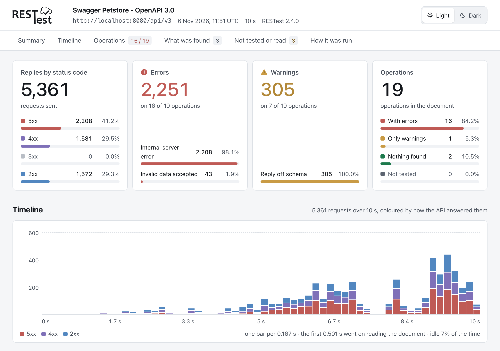
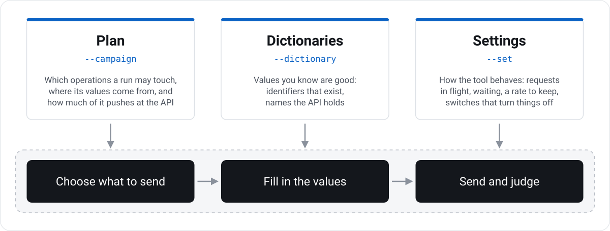

[](https://github.com/isa-group/RESTest/actions/workflows/ci.yml)
[](LICENSE)

> **RESTest 2 is a complete rewrite.** From version 2.0 on, RESTest shares no code with RESTest 1.x
> and is not compatible with it. The last version of RESTest 1.x is
> [1.6.0](https://github.com/isa-group/RESTest/releases/tag/restest-1.6.0), and its code is on the
> [`v1.x`](https://github.com/isa-group/RESTest/tree/v1.x) branch.

# RESTest

RESTest is a black-box testing tool for REST APIs. Give it an OpenAPI document and the address of
the API it describes; RESTest invents requests from the document, sends them for as long as you
allow, checks every reply against what the document promised, and reports what it found wrong —
each fault with a `curl` command that sends the same request again.

Nothing has to be configured first. RESTest reads OpenAPI 2.0, 3.0 and 3.1, and it never looks at
the API's code: the document and the replies are all it needs, so the API can be written in any
language and run anywhere.

Ask your coding agent to use it while it develops your API: RESTest finds the bugs as they appear,
the agent fixes them before they reach you, and the API it hands over keeps the promises of its
document.

## Installation and use

### From a coding agent

A coding agent — Claude Code, Codex, Copilot, Gemini CLI — installs RESTest and runs it for you,
given one sentence:

```
Use RESTest to test the REST APIs you develop: https://github.com/isa-group/RESTest/blob/master/docs/for-coding-agents.md
```

[RESTest and coding agents](docs/for-coding-agents.md) says what the agent then does, and how to
install the skill that teaches it.

### Install

**With Homebrew**, on macOS and Linux, which installs a Java 21 for RESTest as well:

```bash
brew install isa-group/tap/restest
```

**With jbang**, on macOS, Linux and Windows, which downloads a Java for RESTest when there is none:

```bash
jbang app install restest@https://isa-group.github.io/jbang-catalog/jbang-catalog.json
```

**With Docker**, with nothing to install: the image holds RESTest and the Java it runs on, and sees
the folder you are in as `/work`:

```bash
docker run --rm -v "$PWD:/work" ghcr.io/isa-group/restest:2.4.0 version
```

Homebrew and jbang leave `restest` as a command on your `PATH`, and `restest version` says which
RESTest and which Java you have. [Chapter 2 of the manual](docs/manual/02-installing.md) says the
rest: what each way installs, how to make the image a `restest` command that reaches an API on your
own machine, and how to run RESTest on a Java of your own or build it from its source.

### Your first run

Start a pet shop on your own machine, the demonstration API the OpenAPI project publishes as a Docker
image:

```bash
# Start the API to test, on port 8080
docker run -d --name petstore -p 8080:8080 swaggerapi/petstore3:1.0.28
```

It takes a few seconds to start, and on a Mac with Apple silicon Docker runs it in emulation and warns
that the platforms do not match. Once `curl -s http://localhost:8080/api/v3/pet/1` prints a pet, it
is ready. Then test it for ten seconds:

```bash
# Test it for ten seconds, from its OpenAPI document
restest run http://localhost:8080/api/v3/openapi.json \
    --url http://localhost:8080/api/v3 --budget 10s
```

The shop's document gives its address as a path alone, `/api/v3`, which is why `--url` says where it
is running. With RESTest's own image, the container has to reach the shop on your machine, which
[chapter 2](docs/manual/02-installing.md#with-docker) says how to do. RESTest prints each fault as it
finds it and a summary at the end, and leaves its report in `restest-out/`. Open
`restest-out/report.html` in a browser:

<picture>
  <source media="(prefers-color-scheme: dark)" srcset="docs/images/petstore-report-dark.png">
  
</picture>

RESTest tests an operation that creates something by creating something, so a run leaves pets,
orders and users behind; `docker rm -f petstore` and the same `docker run` give you a shop as good as
new. [Chapter 3 of the manual](docs/manual/03-a-first-run.md) goes through a first run line by line,
and [chapter 4](docs/manual/04-reading-what-a-run-says.md) through the report and the page.

### Common options

| Option | What it is for |
|---|---|
| `--budget 5m` | How long to test; a minute by default. |
| `--url http://localhost:8080/api` | Where the API runs, when its document gives no address or only a path. |
| `--auth <key>` | The key or token the API asks for. RESTest sends it where the document says, and hides it in everything it writes. |
| `--set engine.mostRequestsPerMinute=300` | Keeps to a rate, here five requests a second, for a server somebody else runs. |
| `--set engine.maxConcurrency=1` | One request at a time, for an API that falls over when asked two things at once. |
| `--set checks.failOnWarnings=true` | Ends the run with `1` for a warning as well as for an error, so that a build goes red when the API and its document disagree. |
| `--store` | Keeps every request and reply in `restest-out/run.sqlite`. |

`restest help run` lists every option, and [the command line](docs/command-line.md) has them all on
one page.

## Making a run yours



A run needs nothing but the document. Three inputs make it fit your API better; each is optional,
and each has a chapter of the manual.

- **A plan** says which operations a run may touch — only the requests that change nothing, say —
  where its values come from, and how much of it pushes at the API with values nobody sensible would
  send. [Plans](docs/manual/05-plans.md).
- **Dictionaries** hold values you know are good: identifiers that exist, names the API holds. A
  coding agent can write them from the API's document and code before a run.
  [Dictionaries](docs/manual/06-dictionaries.md).
- **Settings** say how the tool behaves: how many requests it keeps in flight, how long it waits, a
  rate to keep, and switches that each turn off one thing a run does.
  [Settings](docs/manual/07-settings.md).

## Exit codes

A run ends with `0` when it found no error and `1` when it found at least one; any other number
means it could not do its job, or was stopped before the end. [Exit codes and continuous
integration](docs/manual/09-exit-codes-and-ci.md) says what each number means and how a build uses
them.

## Documentation

[The manual](docs/manual/README.md) is the place to start: it is read from beginning to end, and
takes you from a first run against a practice API on your own machine to RESTest in your continuous
integration.

[`docs/`](docs/README.md) has a page for each subject: the command line, what a run leaves behind,
the faults, the plan, dictionaries, the JSON Schemas of a dictionary and a plan, the settings, the
switches, coding agents and the known limitations — and, for working on RESTest itself, the design,
continuous integration and the decision records.

## Acknowledgements

RESTest names the faults it finds by the catalogue of
[Web Fuzzing Commons](https://github.com/WebFuzzing/Commons), and is evaluated on the REST APIs of
the [Web Fuzzing Dataset](https://github.com/WebFuzzing/Dataset). We thank everyone who builds and
maintains them.

We thank [Anthropic](https://www.anthropic.com) for access to Claude through the
[Claude Team plan for scientists](https://support.claude.com/en/articles/16634237-claude-team-plan-for-scientists).

## License

Apache License, Version 2.0. See [LICENSE](LICENSE) and [NOTICE](NOTICE). The libraries a release
carries are listed, with their licences, in `THIRD-PARTY.txt` beside this file in the archive and
the image, and in [`dist/THIRD-PARTY.txt`](dist/THIRD-PARTY.txt) in the source.
