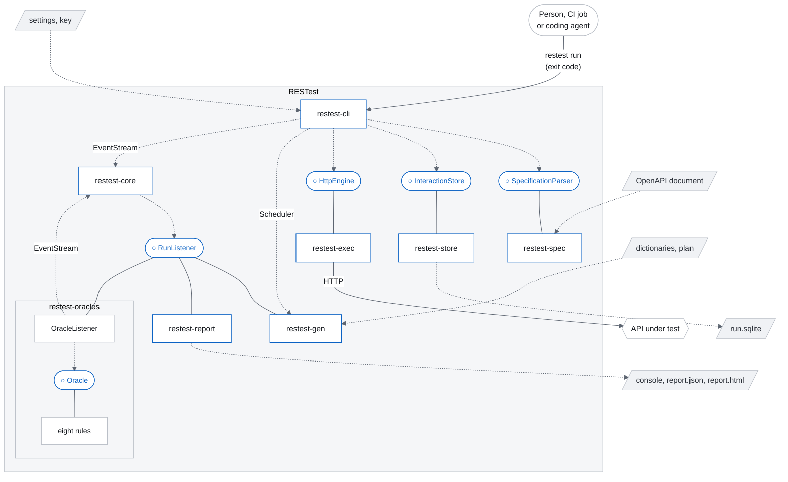

# RESTest Design

RESTest is a black-box testing tool for REST APIs. Its only mandatory input is an OpenAPI
specification; the address of the API is taken from it unless one is given. From those it generates
test cases, executes them, and reports the failures it finds.

The design target is deliberately narrow and deliberately hard: **an unknown API, no human
configuration, a fixed time budget.** Everything below follows from those three constraints.

What RESTest does with them: it reads the document into a model of its own, skipping and
naming what it cannot test; sends every operation once with the request it is most likely to accept;
then, until the budget runs out, builds requests from a plan of weighted sources — the values the
document states, what the API has already returned, values invented to fit what the document says,
lists of values a person hands over — while part of the run pushes at the API with values nobody
sensible would send, changes accepted requests one thing at a time, and sends short series around the
things it creates. Every request is judged by eight rules — a reply of 500, a reply of another server
error, a reply whose body is not the shape the document promised, a 501 to an operation the document
declares, a request broken on purpose that the API accepted, a request the API took on an open
connection and never answered, and a reply whose status code, or whose content type, the document
does not declare — and what they find is reported on the screen, in `report.json` and in a page
drawn from it, `report.html`, with a `curl` command that repeats it; each rule can be switched off. What a user sees of all this is in
[`docs/`](README.md); how it is built is the rest of this page.

From version 2.0 on, RESTest is a rewrite rather than a refactor of RESTest 1.x.

## Scope

| Dimension | Decision |
|---|---|
| Specification formats | OpenAPI 2.0 (by conversion), 3.0.x and 3.1.x, through a single parser backend. Not 3.2, which is too recent to justify a second backend, and not 4.x, which has no specification text |
| Testing style | Black-box only: the specification and the API's responses, never its source |
| Test kinds | Stateless single requests, and stateful sequences across several operations |
| Distribution | A command-line tool: a container image for `linux/amd64` and `linux/arm64`, an archive for any machine with Java 21 or later, or built from source. The image and the archives come from each version tag ([ADR-0032](adr/0032-how-a-release-is-published.md)) |

Black-box is a property of the *tool*, not of the evaluation. Measuring how much of an API's code a
run exercises requires instrumenting that API, which an evaluation harness does from outside; the tool
itself never sees it.

## Glossary

Terms used throughout the repository, in commit messages and in pull requests.

| Term | Plain-language meaning |
|---|---|
| **OAS** (OpenAPI Specification) | The standard file — YAML or JSON — that describes an API: its operations, their parameters, and the shape of their responses. Our only mandatory input. |
| **Black-box testing** | Testing an API from the outside, using only its description and its responses. We never look at the API's source code. |
| **White-box testing** | Testing that also instruments the API's source code or bytecode, usually to get coverage feedback and steer the search with it. Some tools offer both modes; RESTest is black-box only. |
| **Test oracle** | The rule that decides whether a response is right or wrong. "A valid request must not return a server error" is an oracle. Generating requests is half the problem; oracles are the other half. |
| **Stateless / stateful testing** | Stateless: each test is a single, independent request. Stateful: a test is a *sequence* — create a resource, read it, update it, delete it — where each step depends on the previous one. |
| **Inter-parameter dependency** | A rule constraining how parameters can be combined, e.g. "if `location` is given, `radius` must be given too". Not expressible in OAS, which is why IDL exists. |
| **IDL** (Inter-parameter Dependency Language) | A language for writing those rules down formally, so that a machine can reason about them. RESTest 1.x reads it; this tool does not yet ([ADR-0010](adr/0010-idl-strategy.md) says how it will). |
| **IDL4OAS** | The extension that embeds IDL rules inside an OAS document, under `x-dependencies`. |
| **CSP** (Constraint Satisfaction Problem) | The mathematical form an IDL specification is translated into, so that a *solver* can compute combinations of parameter values satisfying every rule at once. |
| **Solver** | The component that does that computation. Not built yet; when it is, it goes behind an interface, so that it is replaceable. |
| **SPI** (Service Provider Interface) | A deliberately small Java interface that the core defines and *somebody else* implements. The core says "give me values for this parameter" without knowing who answers. Adding a capability then means writing one small class and putting it on the classpath — no change to the core. This is the mechanism that makes the tool extensible. |
| **Event stream** | An internal broadcast: the engine announces what it is doing ("request sent", "response received", "failure found") and any number of independent listeners react. Adding an eighth report format does not touch the engine. |
| **AUC** (Area Under the Curve) | A measure of *how fast* a tool achieves something, not just how much it achieves in the end. A tool that covers 15 operations in the first minute scores far better than one covering 15 in the last minute. |
| **Idle time** | The fraction of the test budget during which the tool had no request in flight — time spent computing instead of testing, except for what the API asked for (a 429) or the rate the run was given made, which a run reports apart. Reported on every run. |
| **Opening lap** | The first round of a run: every operation sent once, each with the request it is most likely to accept, in steps — lists, then creations, then reads of one thing, then changes, then deletions — each waiting for the answers to the one before. It is what gets operations answered in the first seconds, which is what AUC rewards. Charged to the budget, reported as a phase of its own, and switched off with `schedule.openingLap=false`. |
| **Scheduler** | The part of the tool that holds the deadline and decides which operation is sent next. It sends nothing itself: the request loop asks it what to do. |
| **Fuzzing** | Sending deliberately malformed or extreme inputs to see whether the API handles them correctly. |
| **Mutation** (of a request) | Taking a request the API *accepted* and sending it again with exactly one thing changed — a required value left out, a number one past the largest allowed, a body that is not JSON at all — so that whatever the API does next can be put down to that one change. Not to be confused with *mutation testing* below, which changes our own code. |
| **Intent** | What a test case says was expected of the API when it was built: that it would be accepted, that it would be refused (and what was broken to make it so), that it is pushing at the API with awkward values, or nothing in particular. Recorded with every request, so that a rule judging the reply later knows which answer would have been right. |
| **WFC** (Web Fuzzing Commons) | A shared, numbered catalogue of API fault types, already adopted by EvoMaster and Schemathesis. Using the same codes makes our fault reports directly comparable with theirs, instead of each tool inventing its own taxonomy. The same project publishes a file format for authentication — users, headers sent with every request, a sign-in whose token later requests carry — which four related tools read ([ADR-0029](adr/0029-the-key-an-api-asks-for.md) §11). |
| **Security scheme, API key** | How a document says an API wants callers to prove who they are. It declares each way under a name — a *key* in a header, the query or a cookie; a bearer token; OAuth 2 — and says which operations need which. The document never holds the key itself: the person running the tool hands it over with `--auth`, RESTest sends it where the document says, and hides it in everything a run writes. |
| **ArchUnit** | A library for writing *tests about the structure of the code itself*, for example "no class in the core may depend on the network layer", so architectural rules fail the build instead of eroding silently. |

## Design principles

Ten, in priority order. They are quoted in `AGENTS.md` and several are enforced mechanically; the
enforcement is listed under [Quality gates](#quality-gates).

| # | Principle | Recorded in |
|---|---|---|
| 1 | Zero configuration to start; full configuration available | |
| 2 | Never crash on a bad specification — skip the offending operation and report it | [ADR-0007](adr/0007-specification-parser-boundary.md), [ADR-0012](adr/0012-canonical-model.md) |
| 3 | Interpret, don't generate. Test cases are data; emitting code is a *report*, never the execution path | [ADR-0005](adr/0005-interpreted-test-model.md) |
| 4 | One event stream, many listeners — reports, metrics, feedback and oracles all subscribe | [ADR-0006](adr/0006-event-stream-and-store.md) |
| 5 | Narrow interfaces, discovered implementations, enforced module boundaries | [ADR-0004](adr/0004-module-structure.md), [ADR-0008](adr/0008-extension-points-no-ai-abstractions.md) |
| 6 | No global mutable state. Two runs must coexist in one JVM | An architecture test |
| 7 | The request loop is never blocked by computation; idle time is measured and reported | [ADR-0009](adr/0009-non-blocking-engine.md) |
| 8 | Open formats in, open formats out | |
| 9 | The tool runs standalone; evaluation harnesses live in a repository of their own, not in this one | [ADR-0011](adr/0011-evaluation-harness.md), amended at M1.9 |
| 10 | Apache-2.0, semantic versioning, published on every tag | [ADR-0002](adr/0002-rewrite-not-refactor.md), [ADR-0032](adr/0032-how-a-release-is-published.md), [ADR-0044](adr/0044-maven-central.md) |

## Architecture

Eight production modules, each with a `module-info.java`, plus one unpublished verification module.
Dependencies point inwards, towards `restest-core`, and [ADR-0004](adr/0004-module-structure.md)
explains why that is compiled rather than conventional.

### Components and interfaces

The diagram below shows the modules, the interfaces through which they meet, and what comes in and
goes out of a run. Each square box is a module. A rounded box marked ○ is an interface of
`restest-core`: a solid line joins it to the module that provides it, and a dashed arrow comes to it
from the module that needs it. A dashed arrow with the name of a class on it is a plain dependency on
that class. A slanted box is a file, a stadium is somebody outside RESTest, and the hexagon is the API
under test.

`restest-oracles` is drawn with two of its parts because it both needs `Oracle` and provides it: its
`OracleListener` puts every reply to the rules, and its eight rules are the implementations. Every
module also depends on `restest-core` for the domain model; the diagram leaves those arrows out.

### The modules

#### restest-core

The language every other module speaks. It holds the model of an API (`ApiModel`, `Operation`,
`Parameter` and the schemas), what a run sends and sees (`TestCase`, `HttpRequestRecord`,
`Interaction`), the faults (`Finding`, with its kind and severity), the settings, and the keys a run
is handed (`Credential`, and `CredentialedEngine`, which adds a key to a request as it leaves). It
also holds `EventStream`, which hands every `RunEvent` of a run to its listeners in order.

It defines the six interfaces the other modules provide — `SpecificationParser`, `HttpEngine`,
`InteractionStore`, `RunListener`, `Oracle` and `ValueProvider` — and needs `RunListener` itself,
for the event stream. It has no network and no OpenAPI parser; its only third-party libraries are a
streaming JSON reader and writer and a YAML reader, behind `io.restest.core.json`.

#### restest-spec

Reads an OpenAPI document — 2.0 by conversion, 3.0 and 3.1 — into the model of `restest-core`. Its
`SwaggerSpecificationParser` provides `SpecificationParser`, and its converters turn the parser
library's types into RESTest's own, so that nothing outside this module sees them: it is the only
module allowed to reference `io.swagger`. A part of the document it cannot read is named, and the
operations it affects are set aside, never the whole run
([ADR-0007](adr/0007-specification-parser-boundary.md)).

#### restest-gen

Decides what to send next and builds it. The `Scheduler` chooses the next operation, first in the
opening lap and then by drawing; the `RandomTestCaseGenerator` builds the request for a draw by the
plan's strategies: a request meant to be accepted, one thing changed in a request the API accepted,
a series around a thing the run created, or a value nobody sensible would send. The values come from
its `ValueProvider`s: the document's own values and examples, dictionaries, what the API has
returned, and values made up to fit the schema. It reads the plan and the dictionaries.

It provides `RunListener` with `AcceptedRequests` and `ObservedValues`, which remember what the API
accepted and returned so that the next request can use it. The library that makes strings match a
regular expression is confined here.

#### restest-exec

Sends requests and captures what goes over the wire. Its `OkHttpEngine` provides `HttpEngine`: it
sends on virtual threads without blocking the request loop, keeps as many requests in flight as the
API can take, keeps to a rate when given one, holds back when the API says to wait, and counts the
time in which nothing was in flight, which a run reports as idle
([ADR-0009](adr/0009-non-blocking-engine.md)).

#### restest-store

Keeps a run, when `--store` asks for it. Its `SqliteInteractionStore` provides `InteractionStore`:
one run, one SQLite file.

#### restest-oracles

Judges every reply. `OracleListener` provides `RunListener`: it puts each request and reply to the
rules and announces each fault on the event stream. The eight rules provide `Oracle`, and `Oracles`
lists them, each beside the switch that turns it off. The JSON Schema validator a reply's body is
checked with is confined here ([ADR-0014](adr/0014-response-conformance.md)).

#### restest-report

Writes what a run found. `ConsoleReport`, `JsonReport` and `HtmlReport` provide `RunListener`; the
page is written from the JSON report's own text, so that it shows nothing `report.json` does not
hold.

#### restest-cli

The command line. `RunCommand` reads the settings from every place they can come from, builds every
other part and subscribes the listeners; `RunLoop` drives the run until the budget runs out, asking
the `Scheduler` for each request, handing it to the `HttpEngine` and announcing what came back; and
`ExitCode` says how the run ended. It needs `SpecificationParser`, `HttpEngine` and
`InteractionStore`, and uses `Scheduler` and `EventStream` directly. It is the only module allowed to
end the process or to read the environment.

#### restest-arch-tests

The architecture rules and the checks that hold the documentation to the tool. It has no main
sources, depends on every module at test scope and is never published ([`docs/ci.md`](ci.md)).

### Execution pipeline

A run is a loop, not a batch. The specification is parsed into a canonical model of our own — not
the parser library's types — operations are scheduled, requests are generated and sent, responses
are captured verbatim, oracles judge them, and every step is announced on the event stream. The one
thing never captured is a key the run was handed: it is added to a request as it leaves, and replaced
in everything that comes back before anything sees it.

### The interaction store

The one architectural choice the principles above do not state. A run may persist everything it
observed, which is what makes honest post-hoc analysis possible: one run is one SQLite file,
readable by anything that reads SQLite, and there is no second store.

It is off unless `--store` asks for it. Measured when it was built, keeping a run costs 661 MiB at the default
budget and nothing in an ordinary run reads it back. Generation never reads it either way: the parts
of the tool that need a memory listen to the event stream and keep their own bounded index, because
they want what happened *recently* rather than everything, and querying the store would put a
database inside the request loop. The store is for looking back; the event stream is for reacting
([ADR-0006](adr/0006-event-stream-and-store.md), amended at M1.4 and M1.7;
[ADR-0013](adr/0013-input-generation.md) §5).

## Extension points

The interfaces of `restest-core` are where RESTest is meant to be extended. Each is implemented
outside `restest-core`, by the modules the table names.

There are deliberately **no abstractions for particular kinds of extension** — no provider interface
named after any technology, and no dependency on any model library.
[ADR-0008](adr/0008-extension-points-no-ai-abstractions.md) sets out why: open formats and a generic
interface outlast a specific integration.

| Interface | What it is for | Implemented by |
|---|---|---|
| **`Oracle`** | Judges one request and the reply to it, and names each fault it finds. | The eight rules of `restest-oracles`. They are also declared as a service, and `Oracles.discovered()` finds anybody's, but a run applies only RESTest's own, each behind its switch. |
| **`HttpEngine`** | Sends a request without blocking the request loop, and counts the time nothing was in flight, so that a regression shows on every run rather than being inferred. | `OkHttpEngine` in `restest-exec`, which `CredentialedEngine` in `restest-core` wraps to add a key to each request and hide it in what comes back. |
| **`RunListener`** | Hears every event of a run, in order, away from the request loop. | The three reports, `OracleListener`, and the parts of `restest-gen` that learn from the replies. |
| **`ValueProvider`** | Offers a value for one place in a request. | The sources of `restest-gen`: the document's values and examples, dictionaries, what the API returned, and values made up to fit. |
| **`SpecificationParser`** | Reads an OpenAPI document into RESTest's own model. | `SwaggerSpecificationParser` in `restest-spec`. |
| **`InteractionStore`** | Keeps every request and reply of a run. | `SqliteInteractionStore` in `restest-store`. |

## Quality gates

All mechanical, all blocking. [`docs/ci.md`](ci.md) describes what runs, where each gate lives and
how to reproduce it locally.

- **Unit tests with coverage thresholds** on the core and the oracles.
- **Architecture tests**: dependencies point inwards; no global mutable state; nothing outside the
  specification module touches the third-party parser; no process termination outside the
  command-line module; nothing outside the command-line module reads the environment or the system
  properties, so that every number a run uses arrives by constructor and two runs in one program can
  differ. That nothing blocks the request loop is not a rule a test can read in the code: idle time
  is measured on every run and reported, so that a change that makes the loop wait shows in it.
- **Documentation held to the tool**: the reference pages that list the command line, the settings,
  the switches, the keys of `report.json` and the kinds of fault are checked against the tool on
  every build, every relative link is checked to lead somewhere, the pages are held to the shape the
  documentation's website reads, the run the manual pictures is held to being a whole default run of
  a version numbered as a release, and the JSON Schemas of a dictionary and a plan are held to RESTest's readers.
- **Mutation testing** on the oracles — deliberately corrupt our own code and
  check that the tests notice. "Our tool finds bugs" is more credible when our own oracle logic has
  a measured score.
- **Integration tests** against containerised open-source APIs.
- **Stub-based tests** for the HTTP layer and for fault injection: malformed bodies, delays, errors.
- **A golden corpus of specifications** — large, real, ugly ones, with recursive references,
  composition chains and OAS 3.1 type arrays — asserting "parses without throwing, and reports
  exactly N skipped operations".

## Evaluation

The quality gates above answer "does the tool work". They do not answer "is it any good", which
needs a comparison against other tools on the same APIs with the same budget.

That comparison runs on [RESTgym](https://github.com/restgym/restgym), a public infrastructure that
runs testing tools against a fixed set of instrumented APIs and computes comparable metrics.
Comparability with published results is exactly what it provides, which is why it is used rather than
a private benchmark of our own. A campaign pins the exact version of both the benchmark and the tool,
so it can be re-run months later and get the same numbers.

RESTgym builds RESTest from [RESTest for RESTgym](https://github.com/isa-group/restest4restgym), a
public repository with what the platform asks of a tool it evaluates — a Dockerfile, the entry point
that runs RESTest, the platform's configuration and the instructions — for one version of RESTest.
Anybody comparing tools on RESTgym can use it to include RESTest. The tool depends on neither: what
the package uses is what any user has, `--url`, `--budget` and the reports
([ADR-0011](adr/0011-evaluation-harness.md)).

Fault reports count by the WFC codes rather than by a taxonomy of our own, for the same reason: a
fault count is only meaningful next to somebody else's fault count. Two kinds the catalogue has no
number for take numbers of RESTest's own, in the range it leaves to tools
([ADR-0036](adr/0036-kinds-of-fault-restest-numbers-itself.md)). What a person reads first is
RESTest's own words, though: every kind has a title of its own and is an error or a warning
([ADR-0037](adr/0037-errors-and-warnings.md)), and the code comes after them.

Every behaviour a run can do without that was added since the tool has had settings — an opening
lap, a mutation operator, a series of requests — has a switch in them
([ADR-0025](adr/0025-settings.md)), and a run records which switches it ran with. An ablation is
therefore a file handed over with `--settings` or `--campaign` rather than a branch per variant, and
its results say what they measured. [The switches](switches.md) lists every one, gives the files
that turn off a whole idea or family of ideas at once and the plan without the memory of what the
API returned, which is a source rather than a switch, and names the two older behaviours that have
no switch yet. A test holds that page to the tool.

## Related tools

We are grateful to the authors of every tool below, and of the research published with them. Their
work made REST API testing a field with shared ideas, open tools and results that can be compared,
and RESTest is part of it because of them.

This section maps the REST API testing landscape for readers new to the field: the tools most often
compared with RESTest in academic evaluations and benchmarks, one paragraph each. The terms it uses
— stateless and stateful testing, black-box and white-box — are in the [glossary](#glossary). The descriptions
of RESTler, EvoMaster, Schemathesis, RestTestGen and CATS were corrected on 10 October 2026 where
their code no longer agreed: RESTler at commit `6d984dee`, EvoMaster at release 6.2.0 and its
development branch at commit `b72feb25`, Schemathesis 4.30.1, RestTestGen v25.12 (commit
`63c19634`) and CATS 14.0.0. Tools change, and a later version may do more.

### AutoRestTest

[AutoRestTest](https://github.com/selab-gatech/autoresttest), from Georgia Tech, came first in
fault detection, efficiency and effectiveness in a 2026 public comparison of black-box REST API
testing tools. It works in two phases. Before testing begins it builds a dependency graph by
comparing the *names* of parameters, body properties and response properties across operations —
with a table of static word vectors, not a language model — and it asks a language model for a pool
of candidate values for every parameter, refining them with the error replies of a couple of probe
requests. The testing phase is then a sequential loop over six learned tables, one for each decision
a request needs: which operation, which parameters, which values, which body properties, which
dependency, which credentials. Its own ablation study removes one component at a time and reports
that removing the learning costs it more than removing the language model.
[ADR-0017](adr/0017-what-we-take-from-autoresttest.md) records what RESTest takes from it, what
it refuses, and what that ablation does and does not establish.

### EvoMaster

[EvoMaster](https://github.com/WebFuzzing/EvoMaster) applies search to REST API testing. Its
white-box mode instruments a JVM application at the bytecode level and feeds coverage into MIO
(Many-Independent-Objective), an evolutionary algorithm that treats each coverage target as an
independent objective, which avoids the stalling that affects single-objective search. Its
black-box mode, the default since 6.0.0, needs only the specification and the running API, and
samples requests rather than evolving them. Call sequences come from the path hierarchy — a creation
before a read of what it created — with identifiers chained from replies; the white-box mode also
infers which resources depend on which. EvoMaster's authors maintain the WFC fault catalogue, and
EvoMaster reports by it, in 37 categories on its development branch.

### RESTler

[RESTler](https://github.com/microsoft/restler-fuzzer), from Microsoft Research, introduced
stateful REST fuzzing guided by the API's replies. A compiler written in F# turns the specification
into a *grammar*: a description of every request RESTler may send, with a slot for each value. While
compiling, it infers *producer-consumer* relationships, for example that `POST /orders` produces an
order identifier that `DELETE /orders/{id}` later consumes. An engine written in Python then chains
operations from the grammar, extending the sequences that worked. Values come from a fixed
dictionary of type-appropriate values, which a user can extend per parameter name; identifiers come
from live replies. Every 5xx counts as a bug, and checkers replay sequences to surface
resource-state problems, such as a resource still usable after it was deleted. Guidance by code
coverage came later, in an extension named Pythia.

### Schemathesis

[Schemathesis](https://github.com/schemathesis/schemathesis) is a Python library and CLI built on
[Hypothesis](https://hypothesis.readthedocs.io/), a property-based testing framework. It generates
inputs from the OpenAPI schema and automatically shrinks failing cases to their minimal form. It
supports OAS 2.0, 3.0.x, 3.1.x and 3.2, integrates as a pytest plugin, classifies findings using WFC
fault codes, and for stateful testing follows OAS `links` and links it infers from the document's
names and from `Location` headers.

### RestTestGen

[RestTestGen](https://github.com/SeUniVr/RestTestGen), from the University of Verona, focuses on
*nominal* and *error* testing. An Operation Dependency Graph, built from the names of parameters and
response fields, orders the operations, and the requests that worked are then mutated to trigger
error responses. Sequences over one resource — create then read, update then read — appear only in its
mass-assignment strategy. It reads OpenAPI 3.0 with a parser of its own, supports IDL-based
inter-parameter constraints, and emits results as JUnit 5 tests.

### CATS

[CATS](https://github.com/Endava/cats) (Contract API Testing and Security, from Endava) offers a
large catalogue of *fuzzers*, each targeting a specific class of input anomaly: boundary values,
special characters, Unicode edge cases, oversized payloads, missing required fields, and extra
unexpected fields. It is designed for repeatable contract testing in CI pipelines rather than for
finding deep behavioural bugs. In release 14.0.0 its stateful checks are two: a `DELETE` takes its
identifier from an earlier `POST`'s reply, and a deleted resource is read again to check it is gone;
its development branch, which its documentation site follows, adds a pool of identifiers and more.

### Dredd

[Dredd](https://github.com/apiaryio/dredd) is a JavaScript contract-testing tool. It executes the
examples embedded in an OAS document against the running API and checks that the responses match.
Stateful sequences require hand-written hook scripts (JavaScript or Python). Dredd is well suited to
regression-testing documented behaviour but is not designed to discover undocumented bugs.

### RESTest 1.x

[RESTest 1.x](https://github.com/isa-group/RESTest/tree/v1.x), also from the ISA Research Group,
implements constraint-based testing (CBT) driven by IDL, random testing, and ART in a single
configurable pipeline. Limited stateful support is available via hand-written test flow
configurations. From version 2.0 on, RESTest is a ground-up rewrite; the reasoning is in
[ADR-0002](adr/0002-rewrite-not-refactor.md).

## Stack

Versions are pinned here and in the root POM, and the container image's two base images in the
`Dockerfile`, by digest; the table names those by their tag. They are expected to agree.

| Component | Choice | Version |
|---|---|---|
| Library bytecode | Java 21 — every module, CLI included ([ADR-0003](adr/0003-java-baseline.md)) | — |
| Build toolchain | JDK 25 (long-term support) | 25 |
| Container image | Built on `eclipse-temurin:25-jdk`, runs on `eclipse-temurin:21-jre` ([ADR-0032](adr/0032-how-a-release-is-published.md)) | 25, 21 |
| Build | Maven with wrapper | 3.9.16 |
| OAS parser | `io.swagger.parser.v3:swagger-parser`, behind our own interface | 2.1.47 |
| JSON Schema validation | `com.networknt:json-schema-validator`, confined to `restest-oracles` in production code ([ADR-0014](adr/0014-response-conformance.md)); the test that holds the published schemas to their readers uses it too ([ADR-0035](adr/0035-json-schemas-of-the-dictionary-and-the-plan.md)) | 3.0.7 |
| Command-line framework | picocli | 4.7.7 |
| HTTP client | OkHttp — network interceptors give exact request and response capture | 5.5.0 |
| Concurrency | Virtual threads | JDK 21+ |
| Interaction store | SQLite (`org.xerial:sqlite-jdbc`), one file per run ([ADR-0006](adr/0006-event-stream-and-store.md), amended at M1.4) | 3.50.3.0 |
| JSON reader and writer | `com.fasterxml.jackson.core:jackson-core`, confined to `restest-core` ([ADR-0006](adr/0006-event-stream-and-store.md), amended at M1.6) | 2.22.3 |
| YAML reader for the files a person writes | `org.yaml:snakeyaml`, confined to `restest-core` and `restest-spec` ([ADR-0006](adr/0006-event-stream-and-store.md), amended at M11.1) | 2.6 |
| Strings matching a regular expression | `com.github.curious-odd-man:rgxgen`, confined to `restest-gen` ([ADR-0022](adr/0022-the-characters-a-value-is-made-of.md)) | 3.0 |
| Unit tests | JUnit Jupiter | 6.1.3 |
| Assertions | AssertJ | 3.27.7 |
| Container-based integration tests | Testcontainers | 2.0.5 |
| HTTP stubbing and fault injection | WireMock | 3.13.2 |
| Mutation testing | PIT | 1.30.0 |
| Architecture tests | ArchUnit | 1.5.0 |
| Coverage | JaCoCo | 0.8.15 |

## External references

Standards:

- OpenAPI Specification — https://spec.openapis.org/oas/
- Web Fuzzing Commons, the shared fault catalogue — https://github.com/WebFuzzing/Commons

## Contributing

Read [`CONTRIBUTING.md`](../CONTRIBUTING.md) first. In short: work targets `master`, one change per
branch per pull request, English throughout, and a design question with more than one defensible
answer becomes an ADR rather than a silent choice in the code.

Individual decisions and the reasoning behind them live in [`docs/adr/`](adr/), and the rules every
contributor follows in [`AGENTS.md`](../AGENTS.md). Continuous integration and the architecture rules
are described in [`docs/ci.md`](ci.md).
